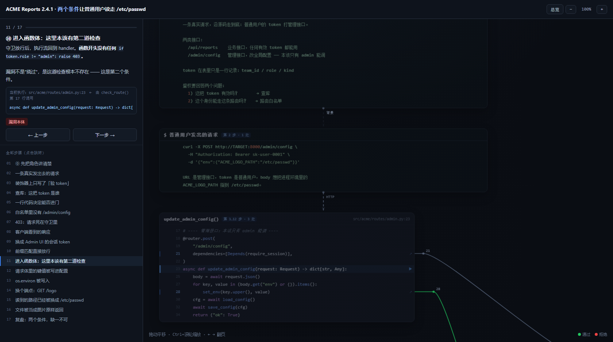

# vuln-path-viz

[中文](README.md) | **English**

**An agent skill that turns a vulnerability write-up into an execution-path diagram you can walk through, one line at a time.**

Install it, then say "turn this vulnerability into an execution-path explainer" — the agent reads the source itself, lays out cards along the call stack, writes the step-by-step narration, and emits a **single self-contained HTML file**: step forward on the left, and on the right watch real source-code cards laid out by call depth, joined by colored edges — which line entered which function, where it forked, where it was blocked, what impact it reached.



## What this is

A **skill package** (`SKILL.md` + references + scripts), not a template file. Its output is a single HTML file with zero dependencies and no build step — double-click it, screen-share it, mail it.

The hard part of giving this to an agent was never "can it draw". It is **will it make things up**. So the repo puts discipline into machine checks:

| Layer | Contents | Job |
|---|---|---|
| `SKILL.md` | five-step workflow, three hard rules, delivery checklist | the agent's task spec |
| `references/authoring.md` | source → diagram: granularity, depth, edge order, evidence grading | writes down *how to think*, so the agent does not improvise |
| `references/data-model.md` · `style.md` | every card/edge/step field; palette, row states, badge vocabulary, copy structure | fixes the data shape and the aesthetics |
| `scripts/lint-scene.mjs` | structural checks + `--src-root` **line-by-line source verification** | fabricated line numbers / misquoted code / wrong card → error |
| `examples/acme-reports/` | synthetic vulnerable source + a 17-step finished page | the few-shot example to copy the shape from |

In other words: **the human reviews, the agent draws.**

## Install

The repo root *is* the skill directory. Anything that understands `SKILL.md` (YAML frontmatter with `name` / `description`) can install it:

```bash
# Claude Code (user level)
git clone https://github.com/searcyan/vuln-path-viz.git ~/.claude/skills/vuln-path-viz

# DeepSeek Harness (user level)
git clone https://github.com/searcyan/vuln-path-viz.git ~/.dsh/skills/vuln-path-viz

# Project level: travels with the repo, shared by the team
git clone https://github.com/searcyan/vuln-path-viz.git .agents/skills/vuln-path-viz
```

Submodules, symlinks, plain copies all work — the only requirement is that `SKILL.md` is readable. Update with `git pull`.

## How to use it

Just talk. The agent decides whether to load the skill:

> Turn CVE-XXXX-YYYY into an execution-path explainer. Source is in `./src/app-1.2.3`, PoC output in `notes/repro.txt`

> Draw this attack chain (see `analysis.md`) as a step-through page, keep it under 15 steps

> Same style as `examples/acme-reports`, but for our admin panel privilege bug — audience is non-engineers

> That page is too long, split it into two tabs by phase

What the agent does next is spelled out in `SKILL.md`: **① anchor one path and one observable impact → ② pull every card's `file:line` and code out of the real source (no recall) → ③ lay cards out by call depth, color edges by outcome → ④ write steps, walking the deny path first and the allow path second → ⑤ run `lint-scene.mjs` (with `--src-root` when source is available) and take headless screenshots, then hand over and tell you which steps matter.**

It will not ask you how to edit a template — that is its job.

## Why it does not fall apart

`node scripts/lint-scene.mjs [--src-root <dir>] <file.html>`

| Kind | Examples |
|---|---|
| error | an edge points at a missing card; a step's line number is not on its card; `via` points nowhere; an edge uses an undeclared `path` color; circled numbering out of order |
| error (`--src-root`) | the code quoted for line 18 differs from line 18 of the source — **this one exists purely to catch fabricated line numbers** |
| warn | a row too long to fit (will be ellipsized); step text over ~420 chars; a new card with neither `via` nor an inbound edge; text citing a line number no card shows; missing recap card |

The page runs the same checks on load and logs to the console. CI runs on every push: template structural lint plus the example with source verification — so the engine and the sample the agent learns from are always working.

The three hard rules (in `SKILL.md`, and the only thing you need to review):

1. **Line numbers must be real** — numbers written from memory collapse the moment a reader opens the source
2. **One path, one line** — forks get one edge each in different colors, not two possibilities narrated inside one card
3. **One thing per step** — second thought, second step

## Manual mode: without the skill

Just want to see what it looks like, or your tooling has no skill support:

```bash
git clone https://github.com/searcyan/vuln-path-viz.git
cd vuln-path-viz

open assets/viz-template.html              # skeleton scene: 6 cards / 6 steps
open examples/acme-reports/viz/index.html  # full example: 17 steps through a privilege-escalation chain
```

To build one by hand, copy the template and edit only the `SCENES` block (between `/* ==== SCENES:BEGIN ==== */` and `SCENES:END`); the engine stays untouched:

```bash
cp assets/viz-template.html my-viz/index.html
node scripts/lint-scene.mjs my-viz/index.html
node scripts/lint-scene.mjs --src-root ./src my-viz/index.html   # also verify against source
node scripts/shot.mjs my-viz/index.html 8 my-viz/step8.png       # headless screenshot
```

Field reference: `references/data-model.md`; palette and copy conventions: `references/style.md`. In this mode Node is only needed for linting and screenshots — **the page itself needs nothing**. The screenshot script finds your local Chrome / Edge / Chromium, or takes `VULN_VIZ_BROWSER`.

## Layout

```
SKILL.md                     the skill body (what the agent reads): workflow, hard rules, checklist
references/
  authoring.md               source → diagram: granularity, depth, edge order, evidence grading
  data-model.md              every card / edge / step field, invariants, via/ret/jump semantics
  style.md                   palette, layout constants, row states, badge vocabulary, copy structure
assets/viz-template.html     engine + skeleton scene; the agent copies it and edits only SCENES
scripts/
  lint-scene.mjs             data linter (with --src-root line-by-line source verification)
  shot.mjs                   headless Chrome/Edge screenshot (cross-platform)
examples/acme-reports/
  src/                       the synthetic "vulnerable" code — line numbers are the reference
  viz/index.html             10 cards / 7 edges / 17 steps, complete example
  shots/                     screenshots
.github/                     CI (validates template + example on every push) and issue templates
```

## What the example is telling

`examples/acme-reports` is a **synthetic** privilege-escalation chain, deliberately shaped like a common real-world bug:

ordinary user token → `POST /admin/config` → `require_session()` looks the token up → `check_route()` hits a shortcut that lets any `kind="ui"` token through on a path prefix → the handler has no role check at all → `set_env()` writes `ACME_LOGO_PATH=/etc/passwd` into `os.environ` → `GET /logo` hands the file back.

It is not a vulnerability in any real product. It exists so every quoted line number can be verified against `examples/acme-reports/src/` with `--src-root` — and so the agent has a shape to learn from.

## Show your viz

Built something with this skill? Open a [Show your viz](https://github.com/searcyan/vuln-path-viz/issues/new?template=show-your-viz.yml) issue and link it — real examples are the most convincing part of this repo.

## License

MIT, see [LICENSE](LICENSE). Example code and docs are yours to modify and redistribute.
