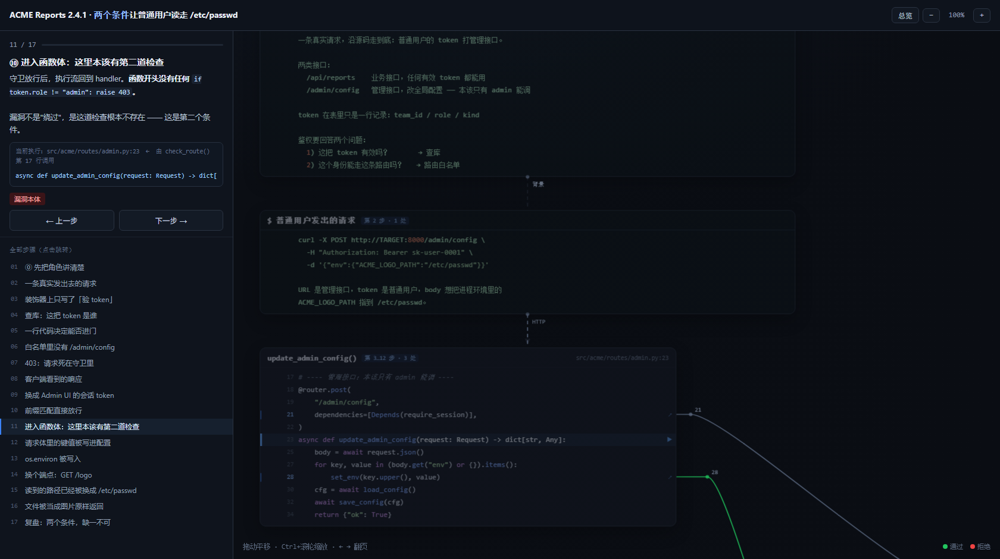

# vuln-path-viz

**把漏洞做成一张能一步一步走完的执行路径图。**

左边一栏点「下一步」讲解，右边一张可拖动缩放的画布：按调用深度分列的**真实源码卡片**，卡片之间用带颜色的曲线连出调用关系 —— 哪一行进了哪个函数、在哪一行分叉、在哪一行被拦下或被放行、最后落到什么 impact。



- **单文件、零依赖、零构建**：产物是一个 HTML，双击就能讲，能随手发给别人
- **行号可核对**：卡片里的代码来自真实文件，`--src-root` 会让自检脚本回去逐行比对（防「凭记忆写行号」）
- **可深链**：`?scene=KEY&step=12` 定格任意一步，能贴进 issue、能无头截图
- **多漏洞 = 多个 tab**：共用一套引擎，一次讲完一个产品上的几条链

它要解决的是「分析写完了，但只有我自己看得懂」：一篇 3000 字的漏洞分析，读者很难在脑子里拼出调用栈；一张只能看不能点的静态图，读者又不知道从哪读起。这个页面把两者缝起来 —— 图给出全局，步骤给出顺序。

## 30 秒上手

```bash
git clone https://github.com/searcyan/vuln-path-viz.git
cd vuln-path-viz

# 直接看效果（不需要任何工具，双击也行）
open assets/viz-template.html            # 骨架场景
open examples/acme-reports/viz/index.html # 完整样例：17 步走完一条越权链

# 拷模板，换成你的代码
cp assets/viz-template.html my-viz/index.html

# 自检 + 截图
node scripts/lint-scene.mjs my-viz/index.html
node scripts/lint-scene.mjs --src-root ./src my-viz/index.html   # 顺带核对源码行
node scripts/shot.mjs my-viz/index.html 8 my-viz/step8.png       # 无头截图看版式
```

需要 Node 18+（只用来自检和截图；**页面本身不需要 Node**）。截图脚本会自动找本机 Chrome / Edge / Chromium，也可以用 `VULN_VIZ_BROWSER` 指定。

## 当成 agent skill 用

本仓库根目录就是一份 skill：`SKILL.md` + `references/` + `assets/` + `scripts/`。支持和 `SKILL.md`（YAML frontmatter：`name` / `description`）的工具都能直接吃：

```bash
# Claude Code（用户级）
git clone https://github.com/searcyan/vuln-path-viz.git ~/.claude/skills/vuln-path-viz

# DeepSeek Harness（用户级）
git clone https://github.com/searcyan/vuln-path-viz.git ~/.dsh/skills/vuln-path-viz

# 项目级（随仓库走，团队共享）
git clone https://github.com/searcyan/vuln-path-viz.git .agents/skills/vuln-path-viz
```

装好后直接说「把 CVE-XXXX-YYYY 做成执行路径讲解页」，agent 会读 `SKILL.md`，按 `references/authoring.md` 从源码推卡片、按 `references/style.md` 写文案，最后跑 `scripts/lint-scene.mjs` 自检。

不支持 skill 的工具也能用：把 `SKILL.md` 和 `references/` 当提示词喂给模型，模板当输出格式。

## 仓库结构

```
SKILL.md                     给 agent 的技能正文：五步产出、三条铁律、交付清单
assets/viz-template.html     引擎 + 骨架场景（6 卡片 / 6 步），改 SCENES 段即可
references/
  data-model.md              card / edge / step 全字段、不变量、via/ret/jump 语义
  style.md                   配色、布局常数、行级状态、徽标词表、文案三段式
  authoring.md               从源码与实测证据推到图：粒度、depth、铺边顺序、证据分级
scripts/
  lint-scene.mjs             数据自检（含 --src-root 源码逐行核对）
  shot.mjs                   无头 Chrome/Edge 截图（跨平台）
examples/acme-reports/
  src/                       合成样本的「漏洞代码」（行号真实可核对）
  viz/index.html             10 卡片 / 7 边 / 17 步的完整样例
  shots/                     截图
```

## 它在讲什么

样例（`examples/acme-reports`）是一条**人为构造**的越权链，形状很常见：

普通用户的 token → `POST /admin/config` → `require_session()` 查库 → `check_route()` 遇到「`kind="ui"` 就按前缀放行」的捷径 → 进 handler，而 handler 里没有角色检查 → `set_env()` 把 `ACME_LOGO_PATH=/etc/passwd` 写进 `os.environ` → 换 `GET /logo` 读走文件。

它不是任何真实产品的漏洞，只是为了让每条 `行号` 都能在 `examples/acme-reports/src/` 里被 `--src-root` 核对上。

## 自检在查什么

`node scripts/lint-scene.mjs [--src-root <dir>] <file.html>`

| 类型 | 例子 |
|---|---|
| error | 边指向不存在的卡片；步骤的行号不在卡片里；`via` 指错；`path` 颜色没声明；序号错位（①…⑯ 与位置不符） |
| error（`--src-root`） | 卡片第 18 行写的代码 ≠ 源码第 18 行的代码 |
| warn | 单行太长会被省略号截断；正文超过 420 字；换了卡片却没有 `via`、也没有入边；正文引用了图里不存在的行号；缺复盘卡片 |

lint 会在打开页面时也跑一遍（出问题打控制台），所以交付前顺手看一眼 DevTools 也不会白看。

## 许可

MIT，见 [LICENSE](LICENSE)。样例代码与文档可随意修改、二次分发。

---

## English

**vuln-path-viz** turns a vulnerability write-up into a step-through HTML explainer: source-anchored code cards laid out by call depth, colored call edges (pass / deny / fork), and a left panel that walks one real request line by line until impact.

Single-file, zero-dependency output. `scripts/lint-scene.mjs` validates the scene data and, with `--src-root`, verifies that every quoted code line still matches the real source file at that exact line number.

Drop the repo into any agent's skills directory (`~/.claude/skills/`, `~/.dsh/skills/`, `.agents/skills/`) — it ships a `SKILL.md`. MIT licensed.
